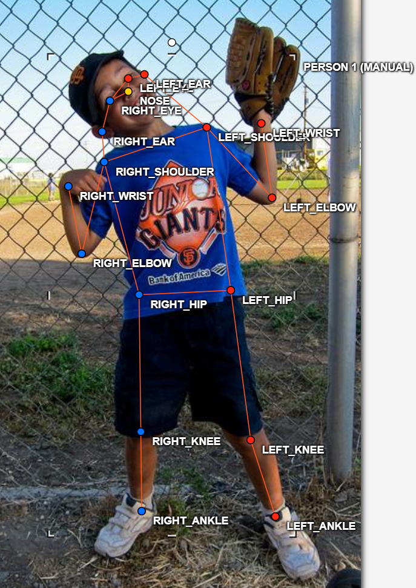
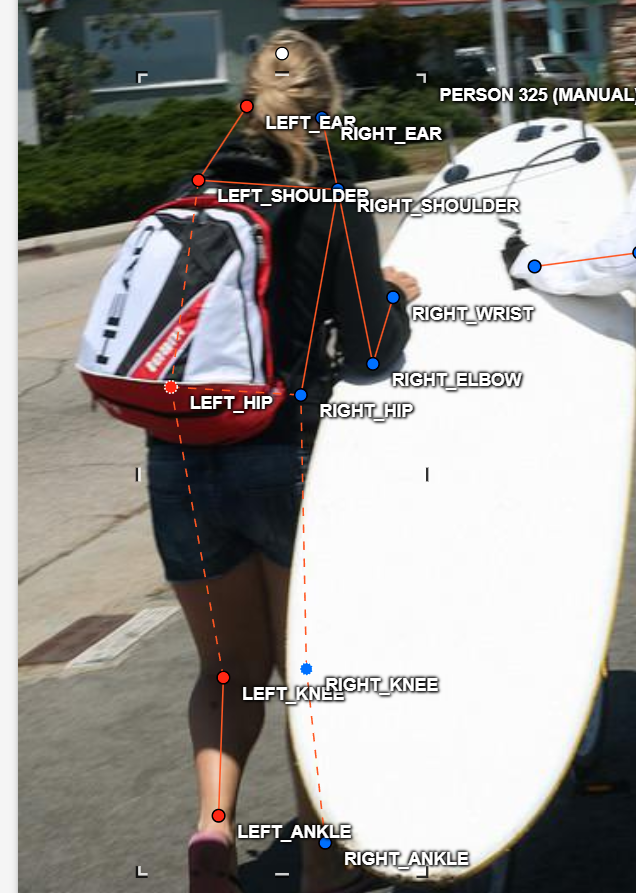
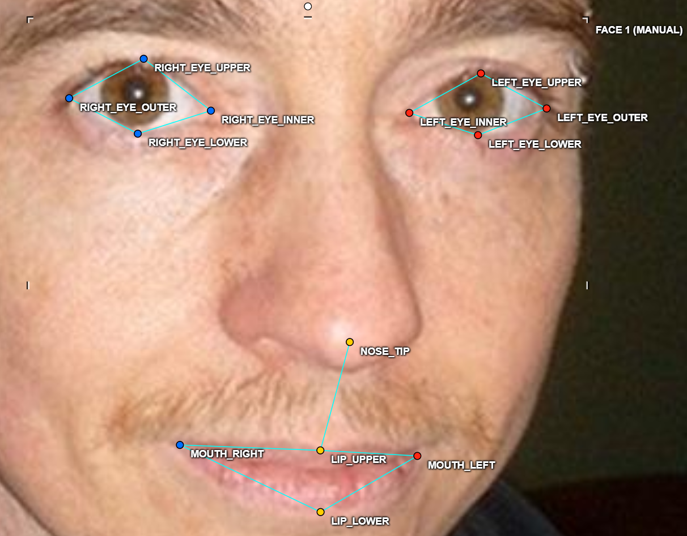
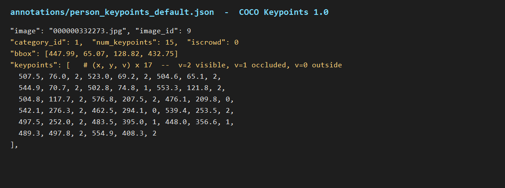

# Báo cáo cá nhân — Bùi Công Đạt — 2A202603068

Dữ liệu: 12 ảnh người COCO val2017 (Lin et al., 2014) và 8 ảnh chân dung Wikimedia Commons, chỉ dùng trong lớp.

## 0. Thông tin học viên

- Họ tên: Bùi Công Đạt
- MSSV: 2A202603068
- MSSV ghi trong `src/exports/assignment.json`: 202603068 (giữ nguyên sau `lab.py setup`; file này là căn cứ để tính lại bộ ảnh khi chấm)
- Email: datcongh43@gmail.com
- Link repository: https://github.com/BuiCongDat2905/K5-L2-DAY04-BuiCongDat-2A202603068-KeypointPose.git
- Phiên bản CVAT (Help → About): Server 2.74.1 · UI 2.74.1
- Máy: Windows 11 · RAM 16 GB · chạy CVAT chế độ đầy đủ
- Bộ ảnh (`src/exports/assignment.json` do `lab.py setup` tạo): có — 12 ảnh người (5 `easy`, 3 `occluded`, 2 `back`, 1 `small`, 1 `crowd`) + 8 ảnh mặt
- Giờ bắt đầu: 16:00 (12/11)
- Giờ kết thúc: 01:00 (13/11)

## 1. Kiểm tra label (CP0)

| Label | Kiểu | Số điểm | Tên điểm đúng bảng của lab? | Đúng thứ tự? | Số cạnh |
|---|---|---:|---|---|---:|
| `person` | Skeleton | 17 | Có (17 tên COCO) | Có | 19 |
| `face` | Skeleton | 13 | Có (13 tên của lab) | Có | 13 |

Mẫu `person` dựng theo người quay mặt về camera (các điểm `left_*` nằm bên phải khung mẫu)? **Có**.

Cách đổi cờ `occluded` / `outside` cho **một điểm** trên phiên bản CVAT này (một câu): rê chuột vào đúng điểm cần đổi rồi bấm `Q` (occluded) hoặc `O` (outside) — hoặc mở menu chuột phải trên điểm để chọn; chỉ điểm đang trỏ bị đổi, các điểm khác giữ nguyên, và không dùng `hidden` vì cờ này không được lưu khi xuất.

## 2. Số lượng đã gán và thời gian (CP1, CP2)

| Nhóm ảnh | Số ảnh | Số skeleton đã gán | Số người dưới 60 px (không gán) | Số poster / gương / màn hình bỏ qua | Thời gian (phút) |
|---|---:|---:|---:|---:|---:|
| `easy` | 5 | 5 | 0 | 0 | 25 |
| `occluded` | 3 | 6 | 0 | 0 | 45 |
| `back` | 2 | 4 | 0 | 0 | 20 |
| `small` | 1 | 1 | 0 | 0 | 10 |
| `crowd` | 1 | 3 | 0 | 0 | 20 |
| `faces` | 8 | 8 | — | 0 | 47 |

- Số ảnh người đã xong ở mốc phút 105: 8 / 10
- Thời gian thực tế (phút): CP1 120 · CP2 47 · CP3 25
- Ảnh tốn thời gian nhất là ảnh nào, vì sao?<br>
  Nhóm `occluded` tốn thời gian nhất, đặc biệt các ảnh người bị che một phần: phần khớp bị khuất vẫn phải ước lượng gần đúng vị trí để chọn giữa `v = 1` và `v = 0`, nên phải zoom và cân nhắc lâu hơn các ảnh `easy`.

## 3. Bảng ca khó (CP1, CP2)

Mỗi điểm bạn phân vân một dòng, nhất là phân vân giữa `v = 1` và `v = 0`, hoặc không chắc hướng người.

| Ảnh | Người / mặt | Điểm | Cờ đã chọn | Phân vân giữa | Lý do chọn |
|---|---|---|---:|---|---|
| `000000069971.jpg` | Người #1 (Winters, quay lưng) | `left_knee` | v = 0 | v = 0 vs v = 1 | Chân bị cắt bởi mép dưới ảnh, khớp nằm ngoài khung nên không có evidence. |
| `000000069971.jpg` | Người #1 (Winters, quay lưng) | `left_ankle` | v = 0 | v = 0 vs v = 1 | Cổ chân nằm ngoài khung ảnh (toạ độ ước lượng y ≈ 602 > chiều cao ảnh 434), không đoán được vị trí. |
| `000000069971.jpg` | Người #2 (áo vest) | `nose` | v = 0 | v = 0 vs v = 1 | Mặt nghiêng 3/4, sống mũi bị khuất; chỉ mắt phải còn thấy nên để outside. |
| `000000078170.jpg` | Người #1 (cửa sổ trái) | `right_elbow` | v = 0 | v = 0 vs v = 1 | Cùi chỏ phải bị khung cửa/thân tàu che hoàn toàn, chỉ thấy vai nên không ước lượng được. |
| `000000147780.jpg` | Người #2 (đứng sau ngựa) | `left_elbow` | v = 0 | v = 0 vs v = 1 | Thân con ngựa che kín tay trái, không thấy khớp. |
| `000000253584.jpg` | Người #1 (snowboarder) | `left_eye` | v = 1 | v = 1 vs v = 2 | Kính trượt tuyết + mũ che, chỉ thấy vùng mắt mờ; vẫn ước lượng được nên để occluded. |
| `000000253584.jpg` | Người #1 (snowboarder) | `right_ankle` | v = 1 | v = 1 vs v = 0 | Cổ chân bị boot/board che một phần, vị trí còn ước lượng được nên để `v = 1`. |
| `000000518966.jpg` | Người #1 | `left_eye` | v = 0 | v = 0 vs v = 1 | Người bị cắt bởi mép phải ảnh, mắt trái nằm ngoài khung. |
| `000000469061.jpg` | Người #2 | `nose` | v = 0 | v = 0 vs v = 1 | Người quay lưng hoàn toàn, không thấy mặt — không đủ evidence. |
| `000000292999.jpg` | Người #1 (batter) | `left_ear` | v = 1 | v = 1 vs v = 2 | Tai trái bị vành mũ che một phần, vẫn ước lượng được vị trí. |
| `000000332273.jpg` | Người #1 (fielder) | `right_wrist` | v = 0 | v = 0 vs v = 1 | Tay phải bị thân người che, chỉ thấy găng ở xa nên để outside. |

## 4. Bảng tự review (CP3)

Đi từ ảnh cuối về ảnh đầu. 5 ảnh người (ít nhất 2 ảnh `back` hoặc `crowd`) và 3 ảnh mặt. Ít nhất 8 dòng, kể cả dòng `ok`. Ghi lỗi trước, sửa sau.

Mã lỗi dùng đúng một trong: `lr_swap`, `vis_flag`, `position`, `missing`, `extra`, `ok`.

| Ảnh | Người / mặt | Điểm | Mã lỗi | Ghi chú | Đã sửa? |
|---|---|---|---|---|---|
| `000000078170.jpg` | Người #1 (cửa sổ trái) | `left_hip` | `vis_flag` | Hông trái bị khung cửa tàu che nhưng vẫn ước lượng được vị trí; lúc đầu để outside, đã đổi sang occluded (`v = 1`). | Có |
| `000000069971.jpg` | Người #1 (Winters) | `right_ankle` | `vis_flag` | Cổ chân phải nằm ngoài khung dưới nhưng ban đầu còn để `v = 2`; đã bật outside (`v = 0`). | Có |
| `000000518966.jpg` | Người #1 | `left_eye` | `vis_flag` | Mắt trái ngoài mép phải ảnh; đã chuyển sang outside. | Có |
| `000000292999.jpg` | Người #1 (batter) | `right_elbow` | `ok` | Heuristic báo cặp `elbow` ngược phía; đã kiểm ảnh: tay cầm gậy bắt chéo, thứ tự trái/phải đúng tư thế → giữ nguyên. | Không cần |
| `000000332273.jpg` | Người #1 (fielder) | `right_ankle` | `ok` | Heuristic báo cặp `ankle` ngược phía; đã kiểm ảnh: người đang bước chân trước/sau nên thứ tự cổ chân như vậy là tư thế thật. | Không cần |
| `face_99874.jpg` | Mặt (kính râm) | `left_eye_upper`, `right_eye_upper`, `right_eye_lower` | `vis_flag` | Kính râm tối: đổi 3 điểm mí còn ước lượng được sang occluded (`v = 1`); 5 điểm mắt còn lại giữ outside vì không đủ evidence. | Có |
| `face_560526.jpg` | Mặt (tóc che) | `left_eye_outer` | `ok` | Tóc che kín mắt trái; giữ outside cho 4 điểm mắt trái, chỉ gán 5 điểm còn nhìn thấy (`num_keypoints = 5`). | Không cần |
| `face_436791.jpg` | Mặt (nghiêng) | `left_eye_inner` | `position` | Mặt nghiêng, khóe mắt trong bị sống mũi che; đã dời điểm sát khóe nhìn thấy thay vì đặt giữa hốc mắt. | Có |

Tổng hợp số lỗi theo mã:

| `lr_swap` | `vis_flag` | `position` | `missing` | `extra` | `ok` |
|---:|---:|---:|---:|---:|---:|
| 0 | 4 | 1 | 0 | 0 | 3 |

Điểm còn phân vân giữa `v = 1` và `v = 0` (ghi cả hai lựa chọn và lý do chọn):

- `000000078170.jpg` — hông trái và đầu gối trái của người trong cửa sổ: chọn `v = 1` vì còn thấy hướng khớp qua lớp vải, dù khung cửa che một phần.
- `000000253584.jpg` — mắt snowboarder: chọn `v = 1` vì kính chỉ che một phần, vẫn xác định được vùng mắt; nếu kính tối hoàn toàn thì sẽ để `v = 0`.

## 5. Kiểm file xuất và kết quả tự kiểm (CP4)

Tự kiểm tay trong file JSON:

| File | Người / mặt kiểm (ảnh, thứ tự) | Số phần tử `keypoints` | Điểm `outside` ra `v = 0`, `occluded` ra `v = 1`? | `num_keypoints` khớp? |
|---|---|---:|---|---|
| `BuiCongDat_persons.zip` | `000000027565.jpg` #1 | 51 | Không có điểm outside/occluded — cả 17 điểm `v = 2` | Có: 17 = 17 điểm `v > 0` |
| `BuiCongDat_persons.zip` | `000000332273.jpg` #1 | 51 | Có: 2 điểm `v = 0`, 3 điểm `v = 1` | Có: 15 = 15 điểm `v > 0` |
| `BuiCongDat_faces.zip` | `face_122747.jpg` #1 | 39 | Không có điểm outside/occluded — cả 13 điểm `v = 2` | Có: 13 = 13 điểm `v > 0` |

Sau khi xuất, CVAT ghi `occluded` thành `v = 1` và `outside` thành `v = 0`. Tọa độ của điểm `outside` trong file là `0, 0` hay tọa độ cũ? **Tọa độ cũ** — cả 70/70 điểm `v = 0` trong file vẫn mang tọa độ cũ (CVAT 2.x xuất như vậy; chuẩn COCO ghi `0, 0`).

Hai job đã chuyển sang completed trên CVAT? **Có** — cả 4 job (2 job chính + 2 job bonus) đều ở state `completed`.

Dán phần **TÓM TẮT** in ra từ `src/check_submission.py`:

```text
- File person: BuiCongDat_persons.zip
  Số ảnh: 12 · số skeleton `person`: 19 · mỗi annotation 51 số
  Skeleton theo ảnh: 000000027565=1, 000000069971=2, 000000072098=1, 000000078170=2, 000000147780=2, 000000150500=1, 000000253584=1, 000000292999=1, 000000332273=3, 000000451084=1, 000000469061=2, 000000518966=2
  Cờ v: v=2 211 (65%) · v=1 55 (17%) · v=0 57 (18%)
  num_keypoints trung bình: 14.0
- File face: BuiCongDat_faces.zip
  Số ảnh: 8 · số skeleton `face`: 8 · mỗi annotation 39 số
  Skeleton theo ảnh: face_122747=1, face_186226=1, face_204787=1, face_436791=1, face_442231=1, face_559185=1, face_560526=1, face_99874=1
  Cờ v: v=2 88 (85%) · v=1 3 (3%) · v=0 13 (12%)
  num_keypoints trung bình: 11.4
- Ghi chú: 70 điểm v = 0 vẫn mang tọa độ cũ (CVAT 2.x xuất như vậy; chuẩn COCO ghi 0, 0). Không phải lỗi: điểm v = 0 bị bỏ qua khi huấn luyện và khi chấm.
- Số [LỖI]: 0 · số [CẢNH BÁO]: 2
Kết quả: ĐẠT (đọc lại từng cảnh báo ở trên)
```

Các `[CẢNH BÁO]` còn giữ nguyên và lý do:

- `000000292999.jpg` #1 — cặp `elbow` nằm ngược phía so với các cặp còn lại: **giữ nguyên**, vì người trong ảnh đang ở tư thế cầm gậy bóng chày, hai tay bắt chéo trước ngực nên thứ tự trái/phải của cùi chỏ khác các cặp còn lại; đã kiểm trên ảnh và overlay skeleton, các điểm nằm đúng khớp.
- `000000332273.jpg` #1 — cặp `ankle` nằm ngược phía: **giữ nguyên**, vì người đang bước dài (một chân trước, một chân sau) nên hai cổ chân không cùng hàng với đầu gối; kiểm trên ảnh thấy điểm cổ chân đặt đúng khớp.

## 6. Ảnh chụp màn hình

1. Label `person` trong label constructor (đủ 17 điểm có tên):

   

2. Một người quay lưng đã gán, cờ đã đặt:

   

3. Một khuôn mặt đã gán 13 điểm, phóng to vùng mắt:

   

4. Một đoạn JSON xuất của một người:

   

   *Ảnh 4 là đoạn `annotations/person_keypoints_default.json` render trực tiếp từ file zip xuất của task `persons-BuiCongDat` (không phải ảnh chụp màn hình CVAT).*

Nguồn ảnh: COCO val2017 / Wikimedia Commons.

## 7. Tự đánh giá

1. Lỗi bạn mắc nhiều nhất hôm nay, và cách bạn sẽ tránh ở dự án thật:

   Lỗi mắc nhiều nhất là **đặt sai cờ `v` cho khớp bị che/cắt** (để `v = 2` cho khớp ngoài khung, hoặc kéo điểm ngoài ảnh về sát mép) và **nhầm trái/phải khi người quay lưng hoặc nghiêng**. Ở dự án thật, trước khi kéo điểm mình sẽ nói to hướng của người, đổi chỗ các điểm `left_*` ngay từ đầu nếu người quay lưng, và với mỗi khớp bị che sẽ tự hỏi đủ bốn câu của guideline (có thấy không, có ước lượng chắc không, có nằm ngoài ảnh không, có phải gương/bóng không) trước khi chọn cờ; zoom 200–400% khi đặt mắt, tai, mí mắt và cổ chân.

2. Một quy tắc bạn đề xuất thêm vào guideline (kèm ảnh ví dụ nếu có):

   Đề xuất thêm bước bắt buộc **"đổi trái/phải trước, tinh chỉnh sau"**: sau khi kéo khung bao người, nếu người quay lưng hoặc nghiêng quá 45° thì đổi chỗ toàn bộ cặp `left_*`/`right_*` trước khi đặt từng điểm, rồi kiểm bằng một checklist 10 giây: nhìn đường nối vai–khuỷu–cổ tay và hông–gối–cổ chân xem có cặp nào bắt chéo bất thường không. Quy tắc này sẽ chặn đúng loại lỗi `lr_swap` mà mình gặp, nhất là ở nhóm ảnh `back`.

3. Nhãn của bạn đi vào model ở đâu? Chọn một lỗi bạn đã sửa và nói nó sẽ làm model học sai thế nào (heatmap, trọng số trong loss, hay bước lật ảnh):

   Mỗi điểm có `v > 0` trở thành một đỉnh heatmap tại toạ độ `(x, y)`; cờ `v` quyết định điểm đó có được tính vào loss hay không (`v = 0` bị bỏ qua, `v = 1` vẫn được tính nhưng là điểm ước lượng), còn cặp `left/right` được hoán đổi khi lật ảnh để tăng dữ liệu. Ví dụ lỗi mình đã sửa: một cổ chân nằm ngoài khung nhưng ban đầu để `v = 2` và kéo về sát mép — nếu giữ nguyên, model sẽ học một đỉnh heatmap sai vị trí và mất khả năng dự đoán cổ chân khi người bị cắt khung (giảm recall ở tư thế đó); ngược lại nếu đặt `v = 0` cho khớp còn ước lượng được thì điểm đó bị loại khỏi loss, model không bao giờ học được khớp đó ở tư thế tương tự. Nghiêm trọng nhất là `lr_swap`: điểm nằm đúng khớp nhưng sai tên làm OKS giảm mạnh, và vì bước lật ảnh hoán đổi trái/phải, model sẽ được dạy rằng tay trái nằm ở phía tay phải.

## 8. Khó khăn và lỗi kỹ thuật

- **CVAT local mất kết nối (khoảng 23:50):** `http://localhost:8080` không truy cập được. Kiểm tra Docker thấy stack CVAT còn 13 container nhưng thiếu 6 container: `traefik` (container publish cổng 8080), `cvat_db`, `cvat_redis_inmem`, `cvat_redis_ondisk`, `cvat_vector`, `nuclio`; `cvat_server` kẹt ở dòng `wait-for-it: waiting for cvat_db:5432`. Nguyên nhân: thao tác nhầm khi dọn container trên Docker Desktop — các container bị xoá nhưng volume dữ liệu vẫn còn.
- **Cách xử lý:** chạy `docker compose -f docker-compose.yml -f components/serverless/docker-compose.serverless.yml up -d` trong thư mục CVAT (`/home/datco/cvat-day2`, WSL Ubuntu) để tạo lại 6 container thiếu. `traefik` publish lại `0.0.0.0:8080->8080`, UI trả HTTP 200, `/api/server/about` trả version 2.74.1; volume `cvat_db`/`cvat_data`/`cvat_keys` còn nguyên nên **không mất nhãn đã gán**. Gián đoạn khoảng 10–15 phút.
- **Bài học:** không xoá từng container khi stack còn chạy; chỉ dừng/khởi động cả stack bằng `docker compose`, dữ liệu nằm trong volume nên tạo lại container không làm mất nhãn.

## Bonus (nếu làm)

Không nộp bonus: task bonus mới gán được 1/3 ảnh người (`persons-extra`) và 1/5 ảnh mặt (`faces-extra`), chưa đủ điều kiện tính điểm bonus.

## 9. Tài liệu tham khảo và công cụ AI đã dùng

**Tài liệu của lớp:** `README.md`, `RULES.md`, `CHECKPOINTS.md`, `RUBRIC.md`, `SUBMISSION.md`, `docs/GUIDELINE.md`, `docs/CVAT_CHEATSHEET.md`, `docs/COCO_KEYPOINTS.md`.

**Tài liệu ngoài:**

- CVAT documentation — skeleton annotation, export COCO Keypoints 1.0: https://docs.cvat.ai

**Công cụ AI:** DeepSeek Harness: hỗ trợ làm báo cáo.
